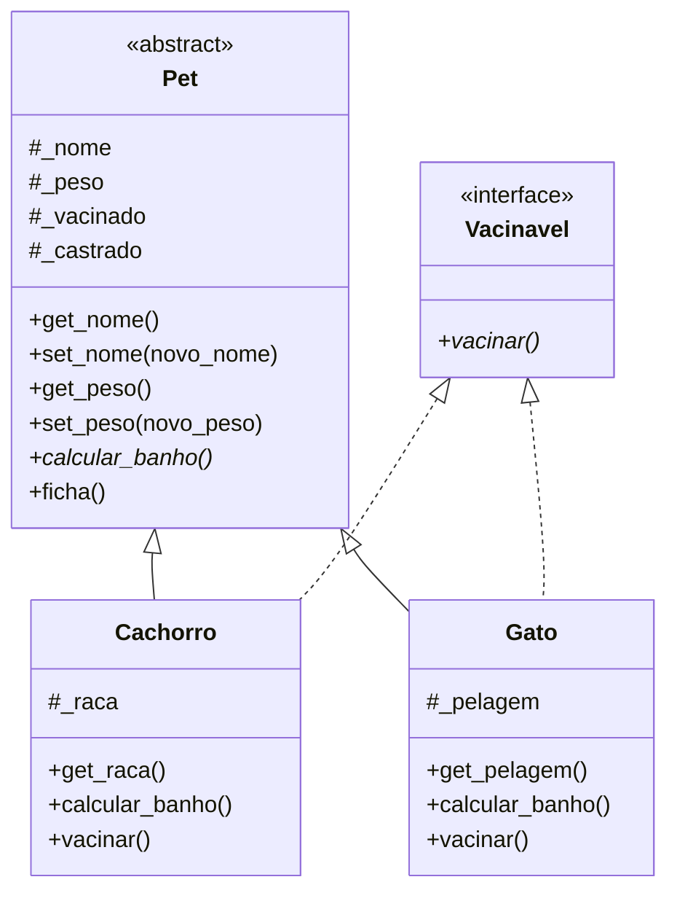

# Pet Shop: Sistema Orientado a Objetos em Python

Sistema de terminal para gerenciar os pets de um pet shop, feito como trabalho final da disciplina de Programação Orientada a Objetos. A ideia é aplicar, num mesmo programa, classe abstrata, herança, encapsulamento, interface, polimorfismo e lista de objetos.

## Funcionalidades

- Cadastrar cachorros e gatos
- Listar todos os pets
- Buscar um pet pelo nome
- Remover um pet pelo nome
- Calcular o preço do banho de todos os pets
- Vacinar todos os pets

O programa já começa com 5 pets cadastrados (2 cachorros e 3 gatos) para facilitar o teste.

## Como executar

Requer apenas Python 3, sem bibliotecas externas.

```bash
python petshop.py
```

No Linux ou no Mac, use `python3 petshop.py`.

## Exemplo de uso

```
=== MENU PET SHOP ===
1 Cadastrar
2 Listar
3 Buscar
4 Remover
5 Acao do sistema
0 Sair
Opcao: 5

--- Acao do Sistema (Polimorfismo) ---
1 - Calcular banho de todos
2 - Vacinar todos os pets
Escolha: 1

Calculando precos:
Bob (18.0kg) -> Banho: R$ 70.00
Caramelo (7.5kg) -> Banho: R$ 50.00
Marrie (4.0kg) -> Banho: R$ 70.00
Leléco (3.8kg) -> Banho: R$ 70.00
Frajola (3.5kg) -> Banho: R$ 50.00
```

## Diagrama de classes



## Conceitos de POO aplicados

| Conceito | Onde aparece no código |
|---|---|
| Classe abstrata | `Pet` herda de `ABC` e tem o método abstrato `calcular_banho()`, que é usado pelo método comum `ficha()` |
| Herança | `Cachorro` e `Gato` herdam de `Pet`, chamam `super().__init__()` e têm atributos próprios (`_raca` e `_pelagem`) |
| Encapsulamento | Todos os atributos são protegidos (`_`) e lidos por getters. `set_peso()` recusa peso zero ou negativo e `set_nome()` recusa nome vazio |
| Interface | `Vacinavel` é uma classe ABC só com o método abstrato `vacinar()`, implementada por `Cachorro` e `Gato` |
| Polimorfismo | Na ação do sistema, o mesmo laço chama `ficha()` e `vacinar()` em todos os pets, e cada tipo responde do seu jeito |
| Lista de objetos | Os pets ficam na lista `lista_pets`, com cadastro, listagem, busca e remoção |
| Representação em texto | `__str__` sobrescrito em `Pet`, `Cachorro` e `Gato`, usado na listagem |

### Regras do banho

- **Cachorro:** depende do porte. Até 10 kg custa R$ 50, até 25 kg custa R$ 70 e acima disso custa R$ 90.
- **Gato:** depende da pelagem. Pelagem longa custa R$ 70 e curta custa R$ 50.

## Por que orientação a objetos?

No estilo imperativo, cada pet seria um dicionário e o cálculo do banho seria uma função cheia de `if` para descobrir se o animal é cachorro ou gato. Cada tipo novo exigiria mexer em todas essas funções. Com classes, cada tipo de pet carrega a própria regra de banho, os setters impedem dados inválidos e o laço da ação do sistema funciona com qualquer tipo de pet sem precisar ser alterado.

## Estrutura do projeto

```
petshop.py   código-fonte do sistema
LEIAME.txt   documentação entregue no trabalho (mapa dos requisitos e reflexão)
README.md    este arquivo
```

## Autor

Daniel Rochadel
